# RevoTask

RevoTask is a Trello-like task management application built through a disciplined, AI-driven workflow with Kiro and Kiro CLI. Users create boards, organize work into columns, move cards between stages by drag-and-drop, collaborate through comments, and track the tasks assigned to them. A Flask API and a Next.js frontend are built to be deployed separately (both on Vercel).

|                |                                                                                            |
| -------------- | ------------------------------------------------------------------------------------------ |
| **Live API**   | _add your API URL (a Vercel project) after deploying, see [`docs/deployment.md`](docs/deployment.md)_     |
| **Live app**   | _add your Vercel URL after deploying_                                                      |
| **Specs**      | [`specs/`](specs/) (requirements, design, tasks, CHANGELOG, traceability)                  |
| **Guidelines** | [`guidelines/`](guidelines/) (backend, database, frontend, violation report, before/after) |

> **Status.** Everything below was built and verified locally: 114 backend tests on PostgreSQL 18 (113 plus one PostgreSQL-only test on SQLite; also passing with the Vercel serverless database settings), 125 frontend unit tests, a 7-test Playwright suite against a production build, and the migrations applied to PostgreSQL. **Not done yet, because they need your accounts:** the two Vercel deployments (API and web), the hosted database, the Postman capture, the Playwright run against the live URL, and live screenshots. [`docs/deployment.md`](docs/deployment.md) has the exact steps and a checklist.

## Users and roles

- **Board member:** creates boards, adds columns and cards, drags cards, comments, edits their own comments, tracks assigned tasks.
- **Board administrator:** everything a member can do, plus rename or delete the board, manage members and roles, delete columns, and view analytics. A board's creator is its first administrator.

## Features implemented

- JWT authentication (hashed passwords, expiring tokens) with protected routes and a safe logout
- Boards, columns and cards with full create, read, update and delete (soft delete, recoverable)
- Drag-and-drop between and within columns using the **FLOAT order strategy**, with an optimistic update that rolls back if the API rejects the move; a "Move to column" control for keyboard and touch
- Comments with owner-only edit and delete
- Notifications with an unread badge in the header, polled every 30 seconds
- Card search with a 300 ms debounce
- My Tasks (cards assigned to you, grouped by board)
- Profile management (name and email; passwords cannot be changed there)
- Board members and roles, and per-board analytics (cards per column, completed this week, member activity) computed with SQLAlchemy joins
- A Playwright suite covering four auth scenarios and the eight-step Kanban journey, with no `waitForTimeout`

## Technologies

**Frontend:** Next.js 15 (App Router), React 19, TypeScript, Tailwind CSS, react-hot-toast, Vitest and React Testing Library, Playwright.
**Backend:** Flask, SQLAlchemy, Flask-Migrate, Flask-JWT-Extended, Marshmallow, PostgreSQL, python-dotenv, Gunicorn, pytest, ruff.
**Delivery:** Vercel for both the API (Flask as a Vercel Function) and the web app, with an external PostgreSQL. **AI tools:** Kiro and Kiro CLI.

## Repository layout

```
backend/app/blueprints/<feature>/{routes,service,schema}.py   auth, boards, columns, cards, comments,
                                                              notifications, analytics, users (+ health)
backend/app/models/            one file per entity        backend/migrations/   reviewed Alembic revisions
backend/tests/                 pytest (SQLite by default, PostgreSQL optional)
frontend/src/app/              pages (Server Components)  frontend/src/components/shared/  BaseButton, BaseBadge, BaseModal, ...
frontend/src/hooks/            useDragAndDrop, useNotifications, useErrorHandler    frontend/src/lib/  apiClient, errors, toast, api
frontend/e2e/                  Playwright                 frontend/e2e-report/      committed test report
specs/                         generated from .kiro/specs/ (requirements, design, tasks, CHANGELOG, traceability)
guidelines/                    backend.md, database.md, frontend.md, violation-report.md, before-after-comparison.md
docs/                          contracts, ADRs, design system, deployment guide, Postman collection, screenshots
scripts/                       guideline, traceability, spec, OpenAPI, Postman and API smoke tools
```

## AI workflow summary

The point of the workflow is not generating faster. It is generating output that can be checked, and checking it before anything is kept. Each step below names the artifact that proves it happened.

1. **Brief.** The assignment text was turned into a project brief (overview, roles, core features, stack, five non-functional requirements) at the top of [`specs/requirements.md`](specs/requirements.md).
2. **Specs.** Requirements were written per slice in `.kiro/specs/NN-*/` as REQ-IDs with EARS acceptance criteria (61 requirements, 185 criteria). Each slice has a `design.md` mapping every requirement to a Flask route or Next.js page, and a `tasks.md` naming the files. [`scripts/build_specs.py`](scripts/build_specs.py) publishes them to `/specs`; [`scripts/check_traceability.py`](scripts/check_traceability.py) fails if any requirement lacks a criterion, a design mapping, a task, or a reference in code or tests. The starter scaffold's version of that script passed with zero requirements, which is recorded as CHANGELOG round R03.
3. **Guidelines first.** [`guidelines/`](guidelines/) holds 36 rules (12 backend, 10 database, 14 frontend), each with a Rule, a Rationale and a RevoTask Example, written before the code they govern. `.kiro/steering/*` include them with `#[[file:...]]` so Kiro loads the same text, and [`scripts/check_guidelines.py`](scripts/check_guidelines.py) runs 28 mechanical checks against them in CI.
4. **Generation and review.** The project began from an AI-generated starter scaffold. Code was generated slice by slice and every file was read against the guideline for its layer, then run through ruff, ESLint, `tsc`, the tests and a production build. Screenshots were reviewed as well, which found layout defects that all tests had passed.
5. **Violations.** [`guidelines/violation-report.md`](guidelines/violation-report.md) lists 22 violations found in AI-generated code (10 in the scaffold, 12 in first drafts), each with the rule broken, the fix and how it was verified. Running the checker on the untouched scaffold fails 11 of 28 checks; the refined repo passes all 28 ([`before-after-comparison.md`](guidelines/before-after-comparison.md)).
6. **Refinement rounds.** [`specs/CHANGELOG.md`](specs/CHANGELOG.md) records 18 rounds, each with the artifact, the observed defect (before), the targeted prompt, the result (after) and the evidence. Examples: tests that wiped the dev database (R14), a fresh comment labelled "edited" (R16), a stale server that made tests fail with no app bug (R17), a generator whose output changed with the hash seed (R18).
7. **Tests alongside code.** Backend tests were written with each blueprint (comments cover 201, 400, 401 and 403), frontend tests with each hook and component, and the Playwright suite last, run against a production build.

### Kiro CLI (to be completed by the repository owner)

Kiro CLI was **not** used in the session that produced this code, so this section cannot be filled in honestly by anyone else. To meet the brief, run it on a real task and record the result here. A suggested sequence that matches the rest of this workflow:

```bash
# 1. Generate tests for a flow, then review them against guidelines/backend.md BE-12
kiro-cli chat "Add pytest cases for DELETE /api/columns/<id> following guidelines/backend.md BE-12"

# 2. Refine documentation from the code, then diff it against specs/design.md
kiro-cli chat "Update docs/deployment.md troubleshooting from backend/app/config.py"
```

See the [Kiro CLI chat docs](https://kiro.dev/docs/cli/chat/) for options such as running non-interactively. Record for each run: the prompt, what Kiro CLI produced, the guideline violations you found in it, and the correction. Add the entries to a slice `CHANGELOG.md` and rerun `python scripts/build_specs.py`. [`guidelines/before-after-comparison.md`](guidelines/before-after-comparison.md) has a scoring protocol for a controlled with-and-without-guidelines comparison.

## Run it locally

Requires Python 3.11+ (3.12 on Vercel), Node 20+, and PostgreSQL 16+ (use `docker compose up -d postgres`, or any local server).

### API (Flask)

```bash
git clone <your-repo-url> revotask && cd revotask/backend
python -m venv .venv
# Windows PowerShell: .venv\Scripts\Activate.ps1      macOS/Linux: source .venv/bin/activate
pip install -r requirements.txt
cp .env.example .env          # then edit DATABASE_URL and generate real secrets (see the comments inside)
flask db upgrade              # applies every migration
flask run                     # http://127.0.0.1:5000  (try GET /api/health)
```

`.env.example` sets `FLASK_APP`, so the `flask` commands work without `--app`. In `APP_ENV=development` missing secrets are generated per process; in `production` the app refuses to start without strong ones.

### Web (Next.js)

```bash
cd frontend
npm install
cp .env.example .env.local    # NEXT_PUBLIC_API_BASE_URL and API_BASE_URL, both ending in /api
npm run dev                   # http://localhost:3000
```

Register an account at `/register`, sign in, create a board, add columns, and add cards. Add a second user, then add them to the board from **Members** to try assignment and notifications.

## Run the tests

| Layer                 | Command (from)                                                                | What it covers                                                                                                                                |
| --------------------- | ----------------------------------------------------------------------------- | --------------------------------------------------------------------------------------------------------------------------------------------- |
| pytest                | `pytest -v` (`backend/`)                                                      | every blueprint, config, migrations. Uses in-memory SQLite.                                                                                   |
| pytest on PostgreSQL  | `TEST_DATABASE_URL=postgresql+psycopg://user:pw@host/revotask_test pytest -v` | the same suite plus the migration drift check. The database name must contain `test`: the fixtures drop every table and refuse anything else. |
| React Testing Library | `npm test` (`frontend/`)                                                      | hooks, shared components, forms, ordering and board-state logic                                                                               |
| Playwright            | `npx playwright test` (`frontend/`)                                           | four auth scenarios, the eight-step Kanban journey (including drag-and-drop and persistence after reload), and mobile layout                  |

**Playwright against the live site** (the deliverable):

```bash
cd frontend
npm ci
npx playwright install chromium
PLAYWRIGHT_BASE_URL=https://<app>.vercel.app E2E_API_BASE_URL=https://<api-project>.vercel.app/api \
PLAYWRIGHT_HTML_REPORT=e2e-report/production npx playwright test
npx playwright show-report e2e-report/production
```

PowerShell: set each variable with `$env:NAME = "value"` first. Run against a **production build** (`npm run build && npm start`) when testing locally; the dev server compiles pages on demand and makes the first visit to a route slow enough to time out. `node scripts/verify-build.mjs <url>` confirms a local server is serving the build on disk.

**Repository gates** (also run in CI): `make gates`, which runs `check_guidelines.py`, `check_traceability.py`, `build_specs.py --check`, `export_openapi.py --check` and `check_encoding.py`. After deploying, `python scripts/api_smoke.py https://<api-project>.vercel.app/api` runs 30 requests across all eight blueprints and prints a pass/fail table.

## Screenshots

> **These were captured against the local production build, not the deployed site.** Re-run `cd frontend && PLAYWRIGHT_BASE_URL=<vercel-url> E2E_API_BASE_URL=<api-url>/api SCREENSHOT_DIR=../docs/screenshots/live npx playwright test --config=screenshots.config.ts` after deploying to produce live ones, and for the Postman screenshot run `docs/postman/revotask.postman_collection.json` against the API URL. Both are on the [deployment checklist](docs/deployment.md).

| Page                                              | Screenshot                                                                                                                                |
| ------------------------------------------------- | ----------------------------------------------------------------------------------------------------------------------------------------- |
| Register                                          | 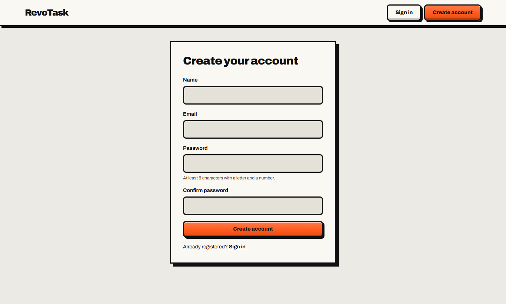                                                                                       |
| Login                                             | 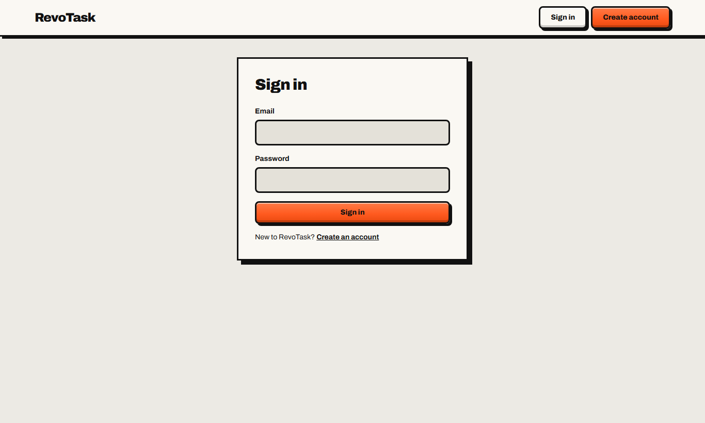                                                                                             |
| Dashboard                                         | 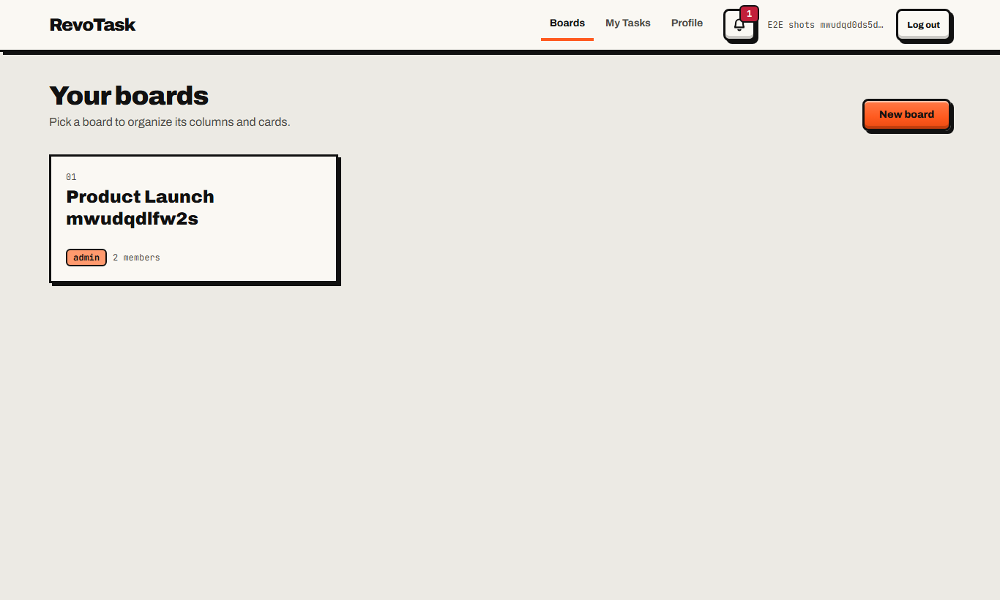                                                                                     |
| Board detail with columns and cards               | 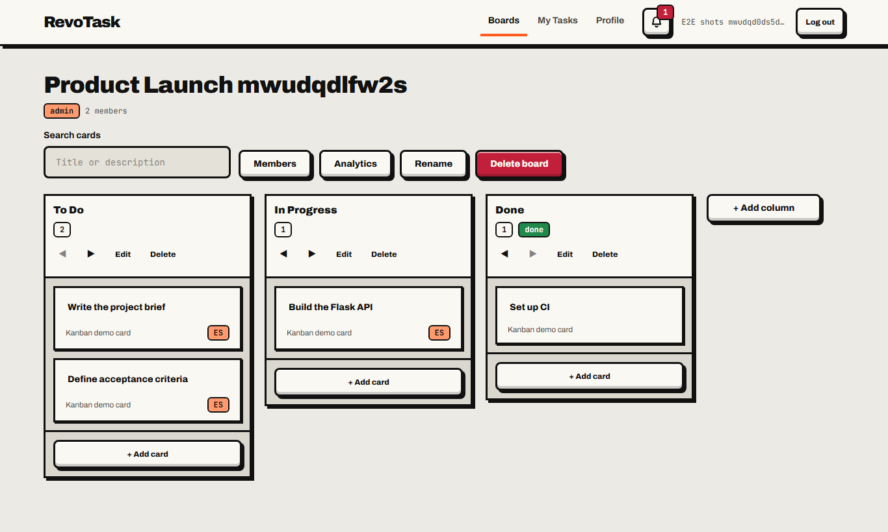                                                                                      |
| Card detail modal with comments                   | 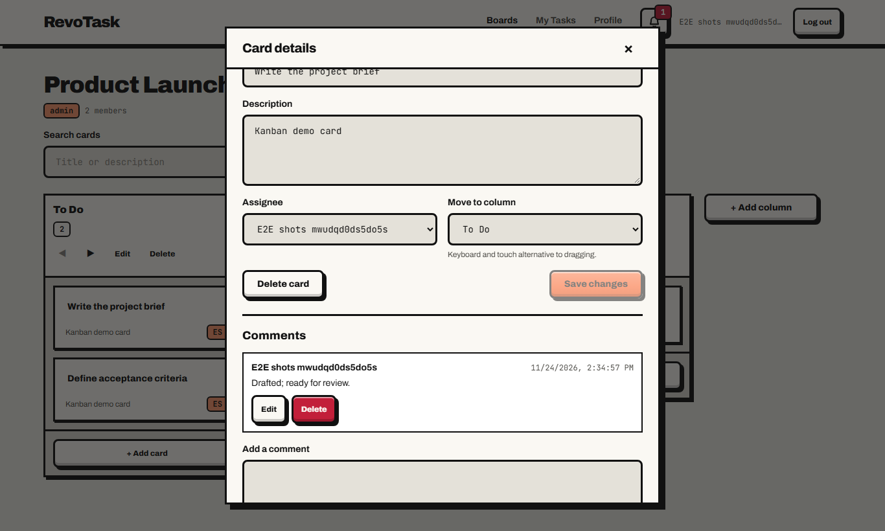                                                                   |
| Card dragged between columns (target highlighted) | 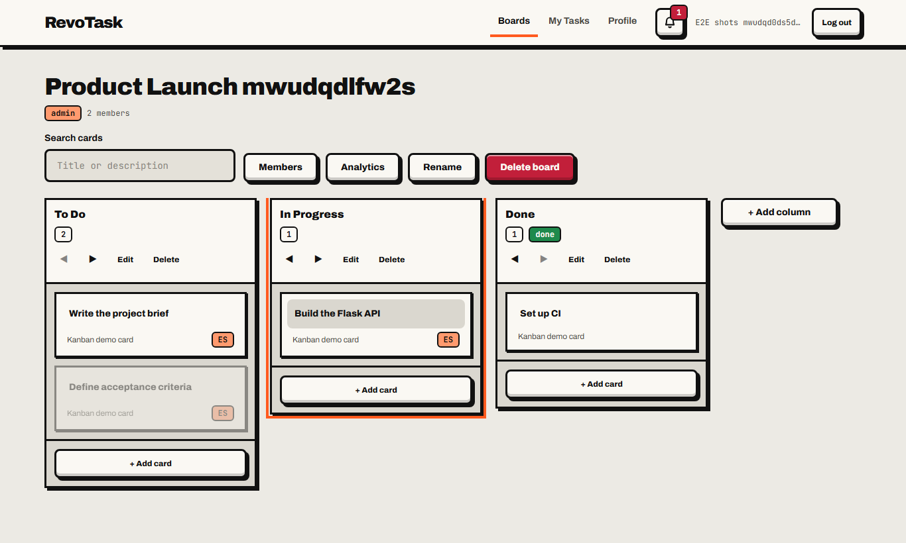                                                                       |
| Card after the drop                               | 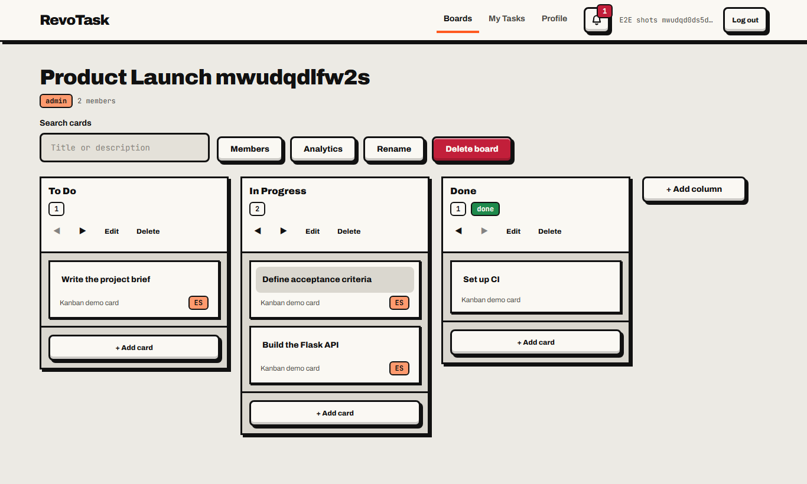                                                                                    |
| Notification bell with an unread count            | 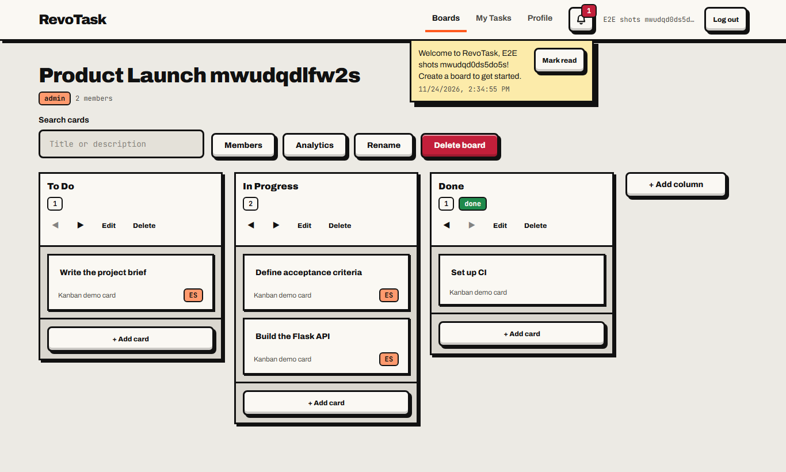                                                                           |
| Analytics (admin)                                 | 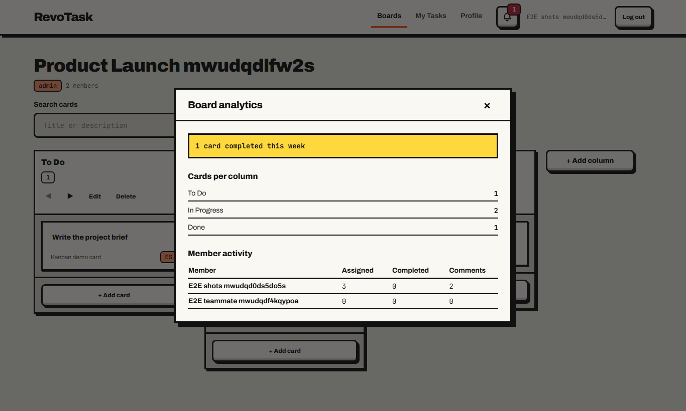                                                                                     |
| My Tasks, grouped by board                        | 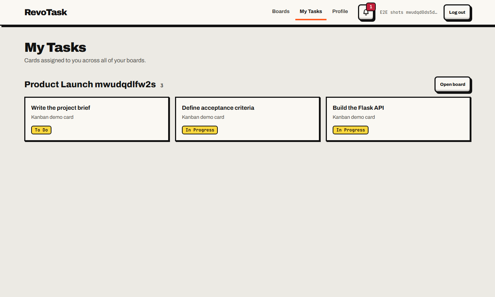                                                                                       |
| Profile                                           | 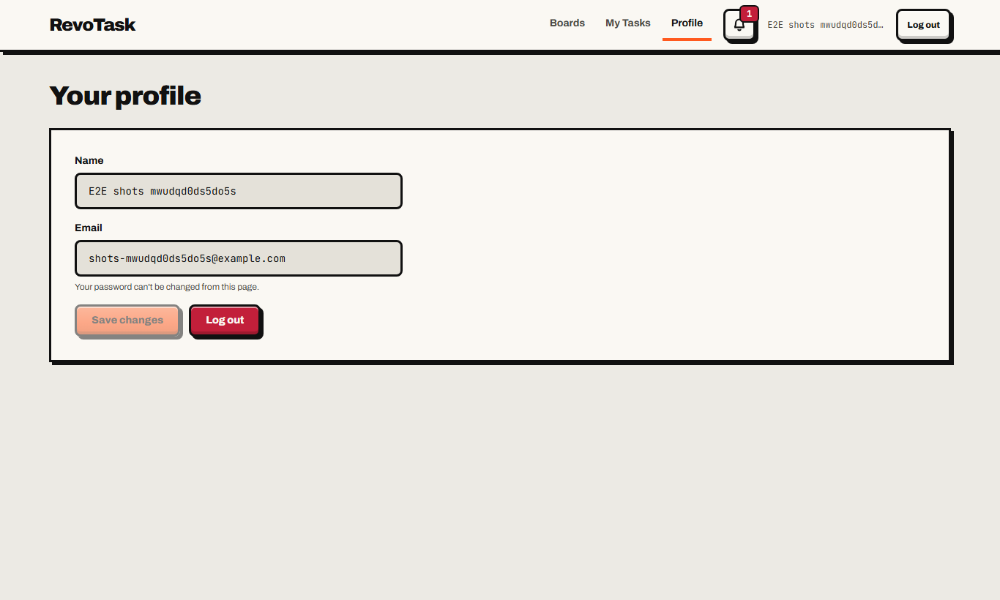                                                                                         |
| Mobile (390 px): dashboard, board, card dialog    | 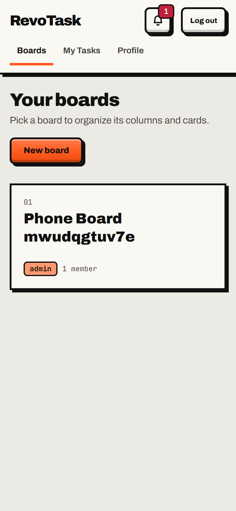 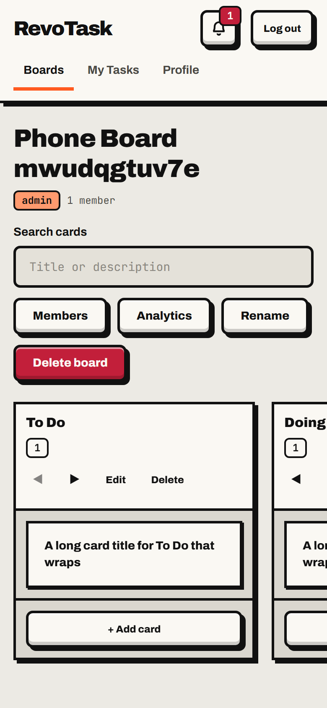 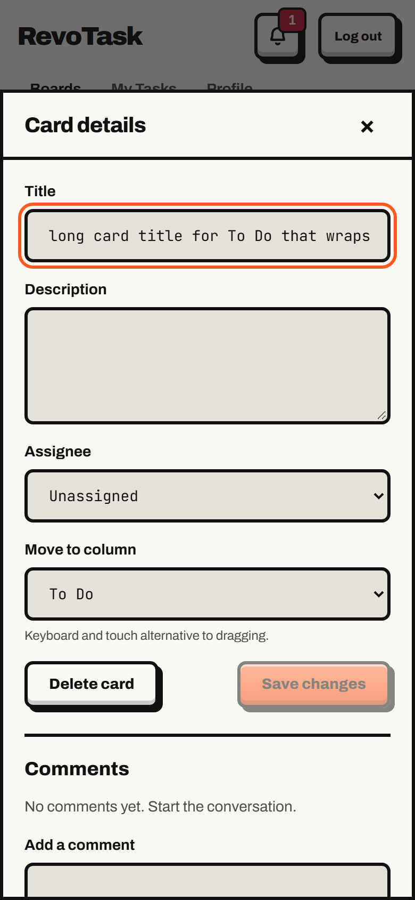 |
| Playwright report                                 | open `frontend/e2e-report/local/index.html` (`npx playwright show-report e2e-report/local`); replace with `production` after the live run |
| Postman, all eight blueprints                     | _capture after deploying; collection and expected results are in [`docs/deployment.md`](docs/deployment.md)_                              |

Two screenshots in [`docs/screenshots/refinement/`](docs/screenshots/refinement/) show the board _before_ the layout fixes (broken column titles, off-center card titles), kept as evidence for CHANGELOG round R15.

## Documentation index

[`specs/`](specs/) · [`guidelines/`](guidelines/) · [`docs/contracts/`](docs/contracts/) (envelope, permissions, ordering, deletion) · [`docs/adr/`](docs/adr/) · [`docs/design-system/`](docs/design-system/) · [`docs/deployment.md`](docs/deployment.md) · [`contracts/openapi.json`](contracts/openapi.json) (generated)

Never commit real `.env` or `.env.local` files; only the `.env.example` templates are tracked.
